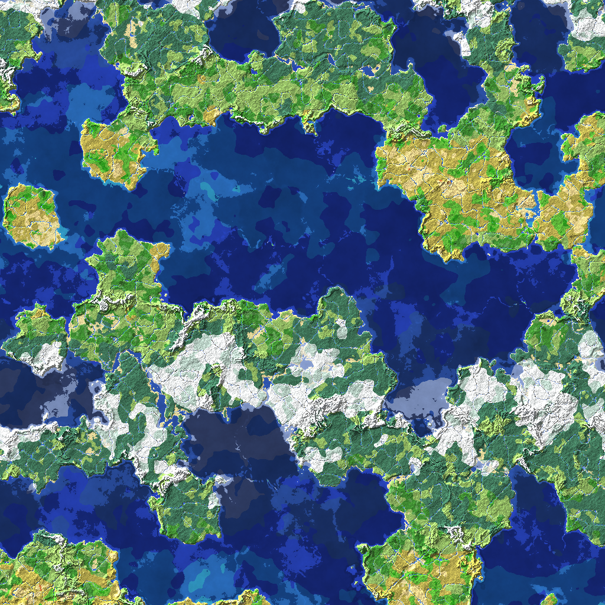
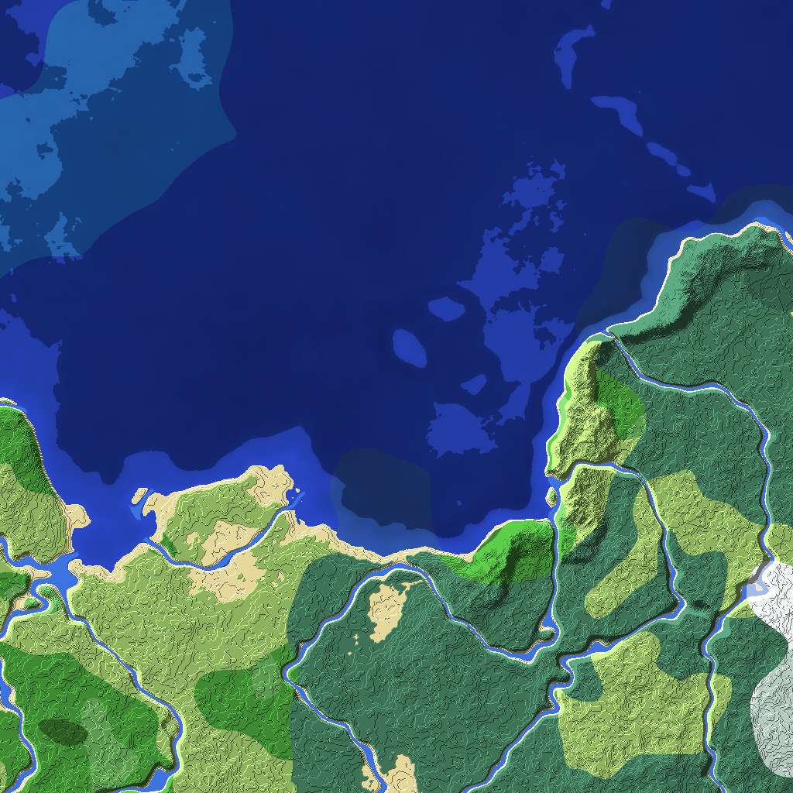

# World generation

`hz_worldgen` builds the overworld's terrain and biomes itself, from tectonic plates.
This page says how, shows what it makes, and covers the alternative: running the real
Lithosphere data pack on Horizon.

## What it makes

Seed 2026, drawn by `cargo run --release -p hz-worldgen-core --example map`.

24,576 blocks across (the picture is centred on 0, 0; north is up):



3,072 blocks across, around the world's centre:



## How it works

The terrain is a function of the seed, the config and a column's position, with no
state. Chunks can be built in any order on any thread, a chunk asked for twice comes
out the same, and far terrain can be drawn before its chunks exist.

1. **Plates.** The map is tiled with plates, about 2,400 blocks across (`plate_size`).
   Each is continental or oceanic and drifts in a direction of its own.
2. **Plate edges.** How two plates move against each other shapes the land between
   them:

   | Plates | Closing | Parting |
   | --- | --- | --- |
   | Continent and continent | A mountain range | A rift valley |
   | Ocean and continent | A trench offshore, a coastal range inland | A quiet shelf |
   | Ocean and ocean | An island arc | A low mid-ocean ridge |

3. **Detail.** Plate edges are bent so coasts curve. Broad swells drown some shelves
   and open bays. Land is rolling inside a plate and rough where it is folded.
4. **Rivers** wind across the lowlands at sea level and fade into valleys higher up.
5. **Climate.** Warm and cold belts run east to west, 9,000 blocks from the middle of
   one to the middle of the next (`climate_band`), their edges bent by noise. z = 0
   lies between a warm belt (north) and a cold one (south), so a world starts in
   temperate land. It is colder with height and wetter near the sea.
6. **Biomes** are picked from temperature, humidity and height: 37 of vanilla's.
7. **Ground.** The terrain paints its own surface (grass, sand, snow, stone, terracotta
   bands), because the game's surface rule reads vanilla's biome map, not this one.

Vanilla then adds its carved caves, its structures and its features (ores, trees,
plants, lakes) on top, each of which the config can turn off. Caves and structures are
kept out of this terrain's water (`fit_to_sea`, below).

Everything is continuous: the height never jumps between neighbouring blocks at a plate
edge. The tests walk tens of thousands of blocks across edges and junctions to hold
that.

## Limits

- **Surface structures can float or sit buried.** Vanilla decides where a structure
  goes, and at what height, from its own terrain. Buried structures fit this terrain;
  villages, outposts and temples may not. `structures = false` removes every
  structure, strongholds included, which closes the way to the End.
- **Structures keep to where both terrains agree about the sea** (`fit_to_sea`, on by
  default). Vanilla places villages, temples and outposts where its own terrain had
  land, and monuments, ruins and shipwrecks where it had sea. A chunk keeps its
  structures only when vanilla's biome at its middle is an ocean exactly when this
  terrain has water in the chunk. A structure that crosses such a coast is cut off at
  the chunk's edge, and a stronghold under this terrain's sea can lose the part there:
  if an eye of ender leads to one whose portal room is gone, travel on until it points
  to another.
- **Caves are carved caves only**, and none in water. The noise caves and aquifers of
  vanilla's terrain are part of what this replaces. Vanilla's carvers fill what they
  cut from vanilla's aquifer, which follows vanilla's terrain, so under this terrain's
  sea they cut dry shafts through the water. With `fit_to_sea` a chunk with water in
  it, or in a column beside it, has no carved caves. In a sample of seed 2026, about
  3% of the chunks away from the sea lost theirs: ones with a river in them, or water
  just beside them.
- **Rivers follow noise, not slope.** They look right from above but do not flow
  downhill from a source.
- Only the overworld is built. A superflat world is left alone.

## Running Lithosphere instead

Lithosphere is a worldgen data pack, and Horizon applies worldgen data packs. It is
written for an older data format, and Horizon ships a tool that upgrades such a pack to
26.3. To use it instead of the tectonic terrain:

1. Set `terrain = "vanilla"` in `config/hz_worldgen.toml`. The mod then does nothing.
2. Download Lithosphere yourself. Its license does not allow redistribution, so it is
   not part of this pack.
3. From a Horizon checkout, upgrade it into the world:

   ```bash
   cargo run --release -p horizon-port-pack -- upgrade-datapack Lithosphere.zip --world <world folder>
   ```

   The command lists what it rewrote and what it could not rewrite faithfully.
4. Create the world with that pack enabled. A data pack changes generation only for
   chunks generated after it is on.

Horizon's `docs/datapack-upgrade.md` and `docs/world-generation.md` say what it applies
from a pack: noises, density functions, noise settings, surface rules, carvers,
features, structures and biomes, but not world presets or biomes the game does not
have. This route was not tested here.

Biome Shift (`hz_seasons`) works on either terrain: it reads the biomes a chunk was
generated with, whoever generated them.
